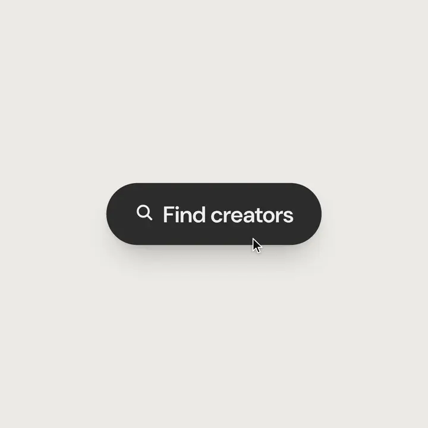

# Product Launch Motion — a Claude Code Skill

### Paste your website URL. Get a product launch video. That's it.

```bash
npx skills add AbubakrChan/product-launch-motion
```

Already installed it? Get the latest version with `npx skills update`.

[](https://github.com/AbubakrChan/product-launch-motion/releases/download/v2.0.0/launch-film-1080p60.mp4)

**No Claude Code? Get the film made for you: a polished launch video in 30 minutes, from $20 → [launchvideos.app](https://launchvideos.app)**

Then, in Claude Code:

> Make a launch video for https://your-website.com

Claude reads your site, writes the story, directs every scene and renders a 60 fps MP4 with
music, synced sound effects and real motion blur. No editing, no After Effects, no templates.
The film above started the same way: a URL, then a few rounds of notes.

<details>
<summary><b>v2 is here.</b> Use it with Claude Opus 5.5 to get results like these films.</summary>

This skill has been rebuilt on a newer, simpler stack: plain HTML and closed-form springs
instead of GSAP and HyperFrames, music-first timing instead of voiceover, and Playwright
subframes with ffmpeg motion blur. **Use it with Claude Opus 5.5 to get results like these
films.** The original v1 (190 ⭐, thank you) is kept in [`legacy/`](legacy/).

</details>

> 🔊 **Download it and turn the sound on.** The preview above is silent. The real film is cut to the beat
> of its music, and every click, whoosh and number roll lands on a drum hit.
> **[Download the film (1080p, 60 fps, with sound)](https://github.com/AbubakrChan/product-launch-motion/releases/download/v2.0.0/launch-film-1080p60.mp4)**
> to watch it as intended.

30 s, made for [cheerful.ai](https://www.cheerful.ai). No After Effects, no stock templates,
no AI video model: every frame is HTML computed from time. Bonus: the same film with a
[WebGL glass pass](https://github.com/AbubakrChan/product-launch-motion/releases/download/v2.0.0/launch-film-glass-1080p60.mp4)
(refractive 3D shapes floating through every scene).

<table><tr>
<td width="45%"><a href="https://github.com/AbubakrChan/product-launch-motion/releases/download/v2.0.0/one-shape-loop-1440.mp4"></a></td>
<td>

**[▶ One shape, never cut](https://github.com/AbubakrChan/product-launch-motion/releases/download/v2.0.0/one-shape-loop-1440.mp4)**
(14 s seamless loop, 1440×1440, with sound)

The idea the whole skill is built on. One element morphs through eleven UI states:
button → loader → check → dynamic island → video reel → slider → toggle → tabs → chart →
⌘K palette → toast → button. Its content swaps with a short blur, the cursor does every
click and drag, and the last frame is the first frame.

</td></tr></table>

[](https://github.com/AbubakrChan/product-launch-motion/releases/download/v2.0.0/hoopoe-club-1080p60.mp4)

**[▶ Hoopoe Club](https://github.com/AbubakrChan/product-launch-motion/releases/download/v2.0.0/hoopoe-club-1080p60.mp4)** · 43 s, Arabic, with sound

---

## What makes it look expensive

These are the rules the skill enforces. Each one came from a review note on a real film
([`references/prompts.md`](references/prompts.md) has the prompts and notes, verbatim).

- **One shape, never cut.** Every state is the same element morphing size, radius and
  colour. Transitions are morphs, camera pushes, or zooms into an element that *becomes*
  the next scene.
- **Blur content swaps.** Text inside a morphing container exits short and early, then the
  new text springs in. Nothing overlaps.
- **Springs, a tiny overshoot at most.** Closed-form damped springs, never bouncy easing.
  Toggle knobs and tab indicators stretch because their two edges ride different springs.
- **A cursor drives everything.** Real clicks with press-scale and ripple, real drags that
  spring back on release. The product's own agent can take over as a second cursor.
- **The camera frames every state.** An empty frame is a bug. Pull-backs reveal scale: one
  email becomes a wall of hundreds.
- **Music first.** The beat grid is measured with numpy, the drop lands on the big moment,
  and every synthesized UI sound is placed by its own measured peak, so it hits the beat.
- **Real data, original scenes.** Real numbers on odometers, customer logos slammed one per
  beat, and nothing copied from the product's website.
- **You get a director.** It makes the creative calls itself and logs each one as a
  `DECISION:` line you can overturn in one reply.

## What's in the box

| Path | What it is |
|---|---|
| [`SKILL.md`](SKILL.md) | The creative direction and the process Claude follows |
| [`references/prompts.md`](references/prompts.md) | The original prompts and every review note, verbatim. Swap the product and reuse them |
| [`references/technique.md`](references/technique.md) | Springs, camera, cursor, odometer, audio and render code patterns |
| [`legacy/`](legacy/) | The v1 skill: voiceover-led films with GSAP + HyperFrames, 34 traps |

## Requirements

| Need | For |
|---|---|
| [Claude Code](https://claude.com/claude-code) with **Opus 5.5** | Directing and building the film. Smaller models follow the rules but miss the detail |
| Node ≥ 20 + Playwright | Rendering |
| FFmpeg | Motion blur, encoding, loudness checks |
| Python 3 + numpy | Beat grid and synthesized SFX |
| A ~120 BPM royalty-free song | Optional. Check each track's licence; some free libraries mix in restricted items |

Everything runs locally and nothing costs money.

## How it works

```
brief ──► state list on the beat grid ──► one HTML film, every pixel = f(t) in seek(t)
      ──► one frame per beat, contact sheet, fix ──► Playwright: 4 subframes per frame
      ──► ffmpeg tmix (motion blur) ──► 60 fps H.264 + mix ──► storyboard + seam scan
```

Because every frame is a pure function of time, renders are deterministic: seek to any
moment and you get the same pixels, which is what makes per-beat QA and parallel rendering
possible.

## v1 → v2

| | v1 (legacy) | v2 |
|---|---|---|
| Timing | Locked to voiceover words | Locked to the music's measured beat grid |
| Motion | GSAP timelines | Closed-form springs, pure `seek(t)` |
| Renderer | HyperFrames | Playwright subframes + ffmpeg `tmix` motion blur |
| Structure | Shots and transitions | One shape that never cuts |
| Sound | Library SFX, levelled | Synthesized SFX placed by measured peak |
| Depth | CSS camera rig | Camera springs + optional WebGL glass |

v1 is still the better choice for a narrated explainer. It lives on in [`legacy/`](legacy/).

### Updating

- **Installed v1 (before 13 October 2026)?** Run `npx skills update`. Your `product-launch-motion` skill is
  replaced by v2.
- **Installed v2 on 13 or 14 October 2026?** It was briefly named `motion-launch-video`, so `update` can't
  find it. Reinstall once:
  ```bash
  npx skills remove motion-launch-video
  npx skills add AbubakrChan/product-launch-motion
  ```
- **Want to keep v1 for narrated explainers?** Install it alongside v2:
  `npx skills add AbubakrChan/product-launch-motion/legacy`

## Made by

Muhammad Abubakr, who builds [Cheerful](https://www.cheerful.ai). Made a film with this skill?
Tag me on X and I'll share it.

[](https://x.com/Muhamma77800831)
[](https://www.linkedin.com/in/muhammad-abubakar-05173b20a/)

## License

MIT for the skill and references — see [`LICENSE`](LICENSE).

**The sample films do not travel.** They were made for Cheerful and are theirs; see
[`NOTICE`](NOTICE) for that and for third-party credits (music, footage, fonts).
